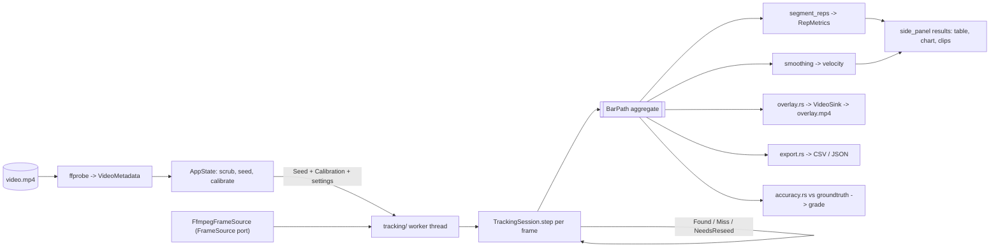
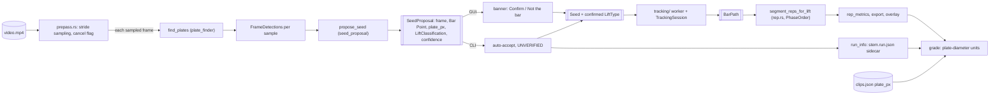

# Architecture

How image-tracker is organised, why the boundaries sit where they do, and the
rules that keep them there. Companion documents: [CONTEXT.md](../CONTEXT.md)
(the ubiquitous language), [docs/code-map.md](code-map.md) (the guided
code-reading tour — mental model, GUI↔core boundary, the algorithm box by box,
and an "open Y to change X" table), [docs/theory.md](theory.md) (the maths and
the sports science), [docs/adr/](adr/) (decision records),
[docs/gui-threading.md](gui-threading.md) (the render-loop rules).

> **New to the code?** Read [docs/code-map.md](code-map.md) first — it's the
> navigation layer. This file is the *rules*; that one is the *tour*.

Last verified against the tree by the Brooks-Lint architecture audit of
**2026-07-23** (health score 69/100). The "Known structural debt" section at
the bottom is that audit's live finding list — it is expected to shrink, and
PLAN.md carries the tasks.

---

## 1. The shape in one sentence

A Cargo workspace of two crates: **`tracker-core`** holds the domain — bar
paths, reps, trackers, calibration — as pure dependency-free Rust, and
**`tracker-app`** holds everything that touches the outside world — ffmpeg
subprocesses, the egui window, the CLI, files and threads.

That split is the whole architecture. Everything below is detail about how it
is enforced.

---

## 2. Module dependency graph

Nodes are modules, not files. Arrows point *from* the dependent *to* its
dependency, so every arrow in this diagram points downward through the layers —
that is the invariant.

```mermaid
graph TD
    subgraph App_UI["tracker-app :: app - egui presentation"]
        Mod["mod.rs - TrackerApp, the eframe update loop"]
        State["state/ - AppState, private fields, accessors"]
        Proposal["state/proposal.rs - seed proposal + FindingBar"]
        SidePanel["side_panel.rs - guide/status/results"]
        VideoPanel[video_panel.rs]
        Toolbar[toolbar.rs]
        BottomBar[bottom_bar.rs]
        Settings[settings_section.rs]
        Thumbs[thumbnail_panel.rs]
        Chrome["palette.rs / theme.rs / banner.rs"]
    end

    subgraph App_Adapters["tracker-app :: adapters, jobs, workers"]
        Cli["cli.rs - headless entry (fan-out 6)"]
        Tracking["tracking/ - config, state, worker, run_loop"]
        Prepass["prepass.rs / prepass_job.rs - unseeded pre-pass"]
        RunInfo["run_info.rs - run.json sidecar"]
        Compare["bench/ - strategy shootout"]
        Decode["decode_worker.rs - display decode thread"]
        ThumbW[thumbnail_worker.rs]
        ExportJob[export_job.rs]
        OverlayExp[overlay_export.rs]
        Ffmpeg["ffmpeg_source.rs / ffmpeg_sink.rs / ffprobe.rs"]
        Grade["grade.rs - ground-truth grading CLI"]
        Cache["frame_cache.rs / seek_source.rs"]
        Telemetry[telemetry.rs]
        ScreenMap["screen_map.rs - video<->screen coords"]
    end

    subgraph Core["tracker-core - zero external dependencies"]
        Ports["PORTS: frame_source.rs / video_sink.rs / metric.rs / tracker.rs"]
        Session["session.rs - TrackingSession state machine"]
        Trackers["tracker.rs (template) / color_tracker.rs / circle_tracker.rs"]
        Reps["rep.rs / rep_metrics.rs / velocity.rs / smoothing.rs"]
        Model["bar_path.rs / calibration.rs / geometry.rs / patch.rs"]
        Vision["preprocessor.rs / color.rs / color_advisor.rs / suggest.rs"]
        Detect["plate_finder.rs / seed_proposal.rs / lift.rs / tuning.rs"]
        Out["accuracy.rs / export.rs / overlay.rs"]
    end

    Mod --> State
    State --> Proposal
    Proposal --> Prepass
    Prepass --> Ffmpeg
    Prepass --> Detect
    Cli --> Prepass
    Cli --> RunInfo
    Grade --> RunInfo
    Reps --> Detect
    Detect --> Model
    Mod --> SidePanel
    Mod --> VideoPanel
    Mod --> Toolbar
    Mod --> BottomBar
    Mod --> Thumbs
    Mod --> Chrome
    Mod --> Decode
    Mod --> ThumbW
    SidePanel --> State
    VideoPanel --> State
    VideoPanel --> ScreenMap
    Toolbar --> State
    BottomBar --> State
    Settings --> State

    State --> Tracking
    State --> ExportJob
    State --> Compare
    State --> Ffmpeg
    State --> Cache

    Cli --> Tracking
    Cli --> Compare
    Cli --> Grade
    Cli --> Telemetry
    Compare --> Tracking
    ExportJob --> OverlayExp
    OverlayExp --> Ffmpeg
    Decode --> Cache
    Cache --> Ffmpeg
    Ffmpeg --> Ports

    Tracking --> Session
    Grade --> Out
    ExportJob --> Out
    Session --> Trackers
    Session --> Reps
    Session --> Model
    Trackers --> Ports
    Trackers --> Vision
    Trackers --> Model
    Reps --> Model
    Out --> Model

    classDef critical fill:#ff6b6b,stroke:#c92a2a,color:#fff
    classDef warning fill:#ffd43b,stroke:#e67700
    classDef clean fill:#51cf66,stroke:#2b8a3e,color:#fff

    class State critical
    class SidePanel,Compare warning
    class Mod,Proposal,Prepass,RunInfo,Detect,Tracking,VideoPanel,Toolbar,BottomBar,Settings,Thumbs,Chrome,Cli,Decode,ThumbW,ExportJob,OverlayExp,Ffmpeg,Grade,Cache,Telemetry,ScreenMap,Ports,Session,Trackers,Reps,Model,Vision,Out clean
```



Colours are the 2026-07-23 audit verdict: 🔴 has a Critical finding, 🟡 a
Warning, 🟢 clean. See §7.

---

## 3. Layers and the dependency rule

| Layer | Lives in | May depend on | Must never depend on |
|-------|----------|---------------|----------------------|
| **Domain** | `tracker-core/src/*` | `std` only | anything — the `[dependencies]` table is empty and stays empty |
| **Ports** | `tracker-core`: `FrameSource`, `VideoSink`, `CorrelationMetric`, `Tracker` | domain types | any concrete adapter |
| **Adapters / jobs** | `tracker-app`: `ffmpeg_*`, `*_worker`, `*_job`, `bench`, `grade` | domain + ports + crates.io | the `app::` UI modules |
| **Presentation** | `tracker-app/src/app/*` | adapters, domain | nothing above it — it *is* the top |
| **Composition roots** | `main.rs`, `cli.rs`, `app::run` | everything | — |

**The one rule:** dependencies point inward, toward the domain. `tracker-core`
declares an empty `[dependencies]`, so the compiler enforces the important half
of that rule — it is physically impossible for domain code to reach for
`egui`, `serde`, `ffmpeg` or the filesystem. `egui` appears inside `tracker-core`
only in prose comments explaining what the module deliberately does *not* do.

The audit found zero dependency cycles and zero upward arrows.

---

## 4. DDD: what is modelled and how

This is a small domain, so it uses the light end of the DDD toolkit — value
objects, one aggregate, one state machine, ports — and skips repositories and
event sourcing, which would be pure ceremony here.

### Ubiquitous language

[CONTEXT.md](../CONTEXT.md) is the authority. Every term there — *Bar Path*,
*Seed*, *Marker*, *Gap*, *Lost*, *Rep*, *Preprocessor*, *Tracking Strategy*,
*Overlay Video* — appears verbatim as a Rust type, method, or field name, and
in test names. If you introduce a concept, add it to CONTEXT.md **in the same
commit** as the type. If you rename a concept, rename it in both places.

The rule is bidirectional, and that is the point: a name that is hard to define
in CONTEXT.md is usually a modelling mistake, not a naming one.

### Value objects

Small, immutable, defined entirely by their attributes, replaced rather than
mutated: `Point`, `Frame`, `Patch`, `Calibration`, `Timebase`, `Sample`. None
carries an identity or a lifecycle. `Calibration` in particular is the
pixel↔metre conversion made explicit — velocity in m/s only exists downstream
of one, which is why the type is threaded through rather than a loose `f64`
scale factor floating around.

### The aggregate

`BarPath` is the one aggregate root: an ordered, timebase-stamped series of
`PathPoint`s plus the metadata needed to interpret them. Everything a user
ultimately gets — the overlay, the CSV/JSON export, reps, velocities, the
accuracy grade — is derived from a `BarPath`. It owns its invariants
(monotonic frame indices, rational fps rather than a lossy float).

### The state machine

`TrackingSession` (`session.rs`) is the domain's behavioural core, not an
anemic data holder: it owns the `SessionState` transitions — `Tracking` →
`NeedsReseed` (recoverable pause) → `Lost` (terminal, and **opt-in, default
off**) — plus gap coasting, interpolation and reseed. The distinction between
those two failure states is a hard-won domain insight, documented at PLAN 17.4b:
a *recoverable* pause asks the human for a new seed and continues; a *terminal*
state throws the rest of the set away. Confidence is not a reliable enough
signal to drive the terminal one, so by default it does not.

### Ports and adapters

Four traits in `tracker-core` are the only doors in or out:

| Port | Domain need | Real adapter | Test double |
|------|-------------|--------------|-------------|
| `FrameSource` | "give me frames" | `FfmpegFrameSource`, `SeekingFrameDecoder` | in-memory synthetic frames |
| `VideoSink` | "write frames out" | `FfmpegVideoSink<W: Write>` | `Vec<u8>`, byte-for-byte asserted |
| `CorrelationMetric` | "how alike are these patches" | `Zncc` | fixture metrics |
| `Tracker` | "follow this thing" | template / color / circle | scripted trackers |

Every one is dependency-free and substitutable without editing the module under
test — which is why 310 of the 667 tests are pure domain tests that run in
under a second with no ffmpeg on the PATH.

### `Job`: illegal states unrepresentable (task 20.5)

`AppState` (app-level session state, not domain — see "Deliberately *not*
DDD" below) drives exactly one background job at a time: a tracking run, an
export, or the strategy benchmark. Before task 20.5 that was three
independent `Option<Handle>` fields (`tracking`/`export`/`benchmark`) — three
bits, 8 representable states, but the domain permits only 4 (idle, or
exactly one running); the other 4 (`Job::Tracking` while `Job::Benchmarking`,
etc.) were illegal states the type allowed and every `can_*`/`poll_*` method
defensively guarded against by hand. `crates/tracker-app/src/app/state/jobs.rs`
now models it as one enum instead:

```rust
enum Job {
    Idle,
    FindingBar { handle: PrepassHandle, progress: Option<(u64, u64)> },
    Tracking { handle: TrackingHandle, paused: bool },
    Exporting { handle: ExportHandle },
    Benchmarking { handle: BenchmarkHandle, progress: Option<(usize, usize)> },
}
```

Mutual exclusion is a compile-time fact — there is exactly one `job` field,
and its variant *is* which job (if any) is active — so "start X while Y
runs" is a match arm that doesn't exist rather than a guarded-against field
combination. `TrackingRunState` (the tracking reducer's accumulated
state — last frame, error, gap count) deliberately stays a top-level
`AppState` field rather than a `Job::Tracking` payload: several call sites
(the bottom status bar's error/paused line) read it *after* the job has
already gone back to `Job::Idle`, so it is a result that outlives the job,
the same as `bar_path`/`results`/`benchmark_rows`/`exported_files`. See task
20.5's PLAN.md row for the full before/after and the deferred follow-up
(20.6: grouping `seed`/`calibration`/`bar_path`/`results` into a
`TrackingRun` value — surveyed at 113 call sites, too large to fold into the
same session as the `Job` enum).

`FindingBar` is the cancelable unseeded pre-pass (`prepass_job.rs`) that
proposes a bar for one-click confirmation. A proposal is never a Seed;
tracking and the benchmark are refused while it runs, a manual seed cancels
it, and dropping the `AppState` (opening another video) cancels it too.
See `state/proposal.rs`.

Because there is one `job` field, "may a seed click be accepted now?" is an
exhaustive `match` over `Job` (`can_place_seed` in `state/session.rs`), not a
set of ad-hoc flags. `place_seed` returns whether the seed was stored; the
caller only runs the tracker suggestion when it was:

| `Job` variant | `place_seed` | Proposal / confirmed lift |
|---|---|---|
| `Idle` | accepted | reset |
| `FindingBar` | accepted; cancels the pre-pass | reset |
| `Tracking`, running | refused, `Warn` event | kept |
| `Tracking`, user-paused (not `NeedsReseed`) | refused | kept |
| `Tracking`, `NeedsReseed` | accepted (the reseed flow needs it); seed only | lift kept |
| `Exporting` | accepted (export owns clones of its inputs) | reset |
| `Benchmarking` | refused | kept |

`AppState`'s fields are all private; call sites use read accessors
(`video_path()`, `metadata()`, `current_frame()`, `seed()`, `calibration()`,
`tracking_run()`, `bar_path()`, `results()`, `selected_rep()`, `events()`) and
the state-transition methods, so a handle can only be reached through the
methods that keep the `Job` invariant.

### Deliberately *not* DDD

There is no repository, no unit of work, no domain events, no anti-corruption
layer. There is one bounded context. Exports (`export.rs`) and the accuracy
grader (`accuracy.rs`) live in core because they are domain
calculations — *what* a CSV row means — while the file writing that
persists them lives in the app. Adding a repository abstraction over "write a
file next to the video" would be the exact speculative generality §7 flags
elsewhere.

---

## 5. How the code is organised

### Directory conventions

```
crates/
├── tracker-core/src/      # one module per domain concept, flat, no submodules
└── tracker-app/src/
    ├── app/               # egui presentation — one module per panel
    ├── *_worker.rs        # long-lived threads that own a resource
    ├── *_job.rs           # one-shot background work
    ├── ffmpeg_*.rs        # subprocess adapters
    ├── cli.rs             # headless composition root
    └── main.rs            # binary entry
```

`tracker-core` stays deliberately flat: 27 modules, no nesting. A domain this
size does not need a package hierarchy, and flat means every concept is one
`grep` away.

### Naming tells you the concurrency model

- `*_worker.rs` — owns a resource on a dedicated thread for the app's lifetime
  (`decode_worker`, `thumbnail_worker`). Communicates by channel. Coalesces
  requests: a burst of stale "want frame N" messages is drained and only the
  newest serviced, so a worker can never fall more than one unit of work behind.
- `*_job.rs` — one-shot, spawned and joined (`export_job`).
- `tracking/` (`config`, `state`, `worker`, `run_loop`) / `bench/` (`strategy`,
  `runner`, `report`, `command`) — the long-running tracking thread and the
  strategy shootout that drives it repeatedly.
- Everything else is synchronous and called from wherever.

### The threading rule

The eframe `update` thread never blocks. No synchronous decode, no subprocess
spawn-and-wait, no file dialog, no `ffprobe` in the render loop. The full rules
and the pre-merge checklist are in [docs/gui-threading.md](gui-threading.md);
they exist because a synchronous decode in `update` was the root cause of the
GUI freeze fixed in PLAN 18.1, and because the pattern is easy to
reintroduce — by humans and by LLMs alike.

### Testing conventions

- Tests live in `mod tests` at the bottom of the file they test — no separate
  test tree.
- Tests target public behaviour, never internals.
- Test names are sentences in the ubiquitous language:
  `a_miss_between_low_confidence_founds_resets_the_suspect_streak`.
- TDD is mandatory for new work: one failing test, minimal code to green,
  refactor.
- No `unwrap()` outside tests.
- Tests needing real ffmpeg are `#[ignore]`d and run manually.

### Correctness is graded, not self-reported

The single most important lesson in this codebase, from the milestone 17 audit:
**the tracker's own metrics measure confidence, not correctness.** Tracked %,
gap count, mean ZNCC score and jitter are all *maximised* by a confident false
lock onto a rack upright. They cannot referee themselves.

The referee is `groundtruth/*.csv` — hand-labelled positions — scored by the
`grade` subcommand against an exported run. Any change to tracking behaviour is
validated by re-grading, not by watching a metric go up. `scripts/smoke-report.sh`
runs that grading in CI. Current proven baseline: v3 85 % within 0.1 plate-dia,
v4 100 % (mean 3.2 px). Background:
[docs/design/tracking-audit-2026-07-21.md](design/tracking-audit-2026-07-21.md),
[groundtruth/README.md](../groundtruth/README.md).

---

## 6. Data flow of one tracking run



The `BarPath` in the middle is the seam: everything left of it is tracking,
everything right of it is derivation and presentation, and every output is a
pure function of the aggregate. That is what makes the domain testable without
a video file.

---

## 6b. The lift-detection layer (auto seed, lift type)

Built on branch `feat/auto-lift-detection` from
[the design](superpowers/specs/2026-10-28-auto-lift-detection-design.md) and
[the plan](superpowers/plans/2026-10-28-auto-lift-detection.md). It lets
`track` and the GUI start with **no Seed**: the software proposes the bar,
names the lift, and the human confirms (GUI) or the CLI marks the run
UNVERIFIED. A proposal is never a Seed until confirmed.



### Core pieces (`tracker-core`, still dependency-free)

- **`plate_finder`** - `find_plates(frame, &PlateFinderConfig) -> Vec<PlateCandidate>`:
  whole-frame gradient-directed circular Hough transform (no seed needed).
  Radius range is a fraction of the shorter side, so it is resolution
  independent. `PlateCandidate.radius_px` is the **outer plate radius**,
  `sleeve_end` is the centre of the small inner collar circle (the **hub
  centre**; found by a second small-radius pass inside the plate, `None` if
  not found), and `score` is unclamped rim evidence. `min_score` (default
  0.4) is a floor on `score`.
- **`seed_proposal`** - `propose_seed(&[FrameDetections], &SeedProposalConfig)
  -> Option<SeedProposal>`. Candidates are linked sample to sample by global
  nearest-neighbour with a speed gate (plate diameters per elapsed frame) and
  a plate-size consistency check; short occlusions are bridged by a separate
  **merge** step with its own, looser **merge-only gates** (speed 0.2, size
  0.15, best successor first). Tracks with low **persistence** (detections /
  samples spanned) are dropped before ranking. Static tracks (floor plates,
  rack hardware) are rejected by a robust vertical range, and the survivors
  are **ranked on a shared scale** (pixel range divided by the frame-level
  plate diameter, not each track's own diameter) so a small circle that moves
  a lot, such as a head, cannot outrank the plate. Confidence comes from
  track length, persistence, travel and ambiguity, never from score
  differences. The proposal sits at the first stable run of the winning track.
- **`lift`** - `LiftType` (`Squat`, `Deadlift`, `Bench`, `Unknown`),
  `TrackPoint`, `LiftClassification { lift, reason }` and
  `classify_lift(&[TrackPoint], &LiftClassifierConfig)`. Distances are in
  plate diameters taken from the track itself. **Unknown carries a reason**
  and the app falls back to manual seeding rather than guessing. `Bench` is
  **never returned from a bar track alone** (a bench bar path looks like a
  short squat), so a bench clip is `Unknown` until bench footage exists to
  tune a rule on.
- **`rep`** - `PhaseOrder { EccentricFirst, ConcentricFirst }` and
  `segment_reps_for_lift(lift, velocity, config)`. A deadlift is
  concentric-first: a rep is pull, optional lockout, lowering, and ends only
  when the bar rests on the floor (an idle run, however brief); a bounce stays
  one rep. **Role-swap trap:** for `ConcentricFirst` the three index fields of
  `Rep` (`eccentric_start`, `bottom`, `concentric_end`) swap phase roles
  (`eccentric_start` is the start of the pull, `bottom` the lockout,
  `concentric_end` the end of the lowering). Never read them by name for
  meaning; use the phase-neutral accessors `start_frame_index`, `end_index`,
  `turn_index`, `bottom_index`, `eccentric_span`, `concentric_span`.
  `rep_metrics`, the overlay and the exporters use the accessors.
- **`tuning`** - the pure tuning-to-config mapping (`default_tracker_config`,
  `session_config`, `rep_segmentation_config`, ...), moved out of the app so
  the CLI, GUI and bench build configs through one place.

### App pieces (`tracker-app`)

- **`prepass`** - `run_prepass(decoder, frame_count, stride, &cancel,
  on_progress)`: decodes every `stride`-th frame (`DEFAULT_PREPASS_STRIDE` =
  4), runs `find_plates` on each, then `propose_seed`. A sampled frame with no
  plate is recorded as an **empty** `FrameDetections` entry (the proposer must
  see the gap); a frame whose **decode fails is skipped**, not recorded. The
  pre-pass errors only if every sampled decode fails or `stride` is 0. The
  cancel flag is checked before each sample.
- **`prepass_job`** + **`Job::FindingBar`** - the background, cancelable
  version for the GUI (worker thread, mpsc channel, handle whose `Drop`
  cancels). `state/proposal.rs` owns the proposal state, the banner text
  ("Finding the bar... N%"), confirm / reject / cancel, and falls back to
  manual seeding when no proposal comes back. The single-job invariant and the
  `place_seed` table are in section 4.
- **`run_info`** - `<stem>.run.json` sidecar (`RunInfo`: `lift`,
  `lift_reason`, `verified`, `seed_frame`, `seed`, `detected_plate_px`). Written **only
  for auto runs**; a manual run removes a stale sidecar of the same stem so
  `grade` never reads a lift for a seeded run. The existing export shapes
  (`<stem>.json` is a top-level array) are untouched; this is why the
  provenance lives in a separate file. No sidecar means "verified" (older
  runs).
- **`bench/`** - the strategy shootout, moved from `compare.rs` as a pure
  move (`strategy`, `runner`, `report`, `command`). **`tracking/`** - the old
  `tracking.rs` split into `config`, `state`, `worker`, `run_loop`.

### Grading

`grade --manifest groundtruth/clips.json --clip <id>` reads `plate_px` from
the manifest (an explicit `--plate-px` overrides it), and checks the run's
lift type and rep count against the owner's `lift` / `reps`. See
[RUNNING.md](../RUNNING.md) and [groundtruth/README.md](../groundtruth/README.md).

### Known limits (read before trusting the numbers)

- **Acceptance against hand labels has not happened yet.** The owner's v5-v8
  labels (`reps`, `plate_px`, bar position) are still empty. The only
  evidence so far is the four clips below, run by hand.
- **Thresholds were tuned on four clips** (v5-v8: two deadlifts, two
  squats): finder `min_score` 0.4, link gate 0.12 plate/frame, merge gates
  0.2 / 0.15, persistence 0.5, the 0.6 relative-diameter rule, lift
  classifier rise/depth values. Treat them as a starting point; expect to
  retune once labels exist. Known weak spots: `min_score` 0.4 is borderline on
  blurred or low-contrast plates (true plates 0.40-0.42, spurious up to
  0.50); the merge size tolerance 0.15 can leave a plate track split after a
  blurred re-acquisition, which would make the proposal late; an oversized
  moving false positive can hide the real plate through the shared scale.
- **Bar Point is the hub centre** (`sleeve_end`). On v5 the physical bar tip
  may sit roughly 25-30 px below the hub centre (about 0.12-0.15 plate
  diameters, above the 0.1 grading tolerance). Whether a correction rule is
  needed is to be settled by the owner's labels.
- **Handheld camera drift** is not compensated: the speed gates and the
  static-track test assume a roughly fixed camera.
- **Bench is never auto-detected**, and an `Unknown` lift always falls back to
  manual seeding.
- **The GUI flow is not visually verified.** The app was started and the
  pre-pass ran in the background without panic, but ring position and size,
  label legibility, the banner layout, and the Confirm -> Track -> results
  path were not looked at or clicked through in a real window.

---

## 7. Known structural debt

From the Brooks-Lint architecture audit, 2026-07-23. Each item follows
Symptom → Consequence → Remedy, and each has a PLAN.md task.

### ✅ Resolved: `AppState` was a god object — PLAN 19.5, closed by 20.1

`app/state.rs` (2708 lines) is now `app/state/{mod,jobs,review,session}.rs`
(963/734/615/369 lines, plus a 156-line shared `test_support.rs`) — split by
concern into `state/jobs.rs` (the three
handle/poll pairs), `state/review.rs` (`SessionResults`, rep selection, clip
playback) and `state/session.rs` (seed, calibration, frame position), with
`mod.rs` keeping `AppState` itself plus the cross-cutting status/banner/
session-lifecycle methods. Pure move + re-export (call sites unchanged); see
PLAN 20.1's Observations for the split-shape rationale.

### ✅ Resolved: divergent change in `state.rs` — PLAN 19.5, closed by 20.1

Same remedy as above: the three `poll_*` pairs (tracking/export/benchmark)
are now three separate files, so a benchmark regression and a Review UI
tweak no longer touch the same file region.

### ✅ Resolved: `side_panel.rs` mixed three abstraction levels — PLAN 19.5, closed by 20.1

1338 lines holding education copy, status sections, the rep table, a
hand-painted velocity chart with nine layout constants, and file/event
sections is now 570 lines of section orchestration; the rep table, velocity
chart + headline cards, and education copy moved to
`app/results/{rep_table,velocity_chart,education}.rs`.

### ✅ Resolved: two more files past the size threshold — PLAN 19.6, guardrail landed 20.2

At the time of the audit, `tracking.rs` (2043 lines, 1076-line production
body) and `compare.rs` (1640 lines, 1066-line production body) were on the
same trajectory `state.rs` took; the audit that flagged `app.rs` at 872
lines was right early. Both have since been split: `compare.rs` into the
`bench/` module and `tracking.rs` into `tracking/`. Rather than refactor two
stable, well-tested files that milestone, `scripts/check-file-sizes.sh` was
made to fail CI on any non-test `.rs` body over 800 lines, with these two as
an explicit, commented allow-list entry — so this stops being rediscovered by a
manual audit and instead gets caught at the PR that introduces new bloat.

### ✅ Resolved: two disproven tracker strategies in the compare matrix — PLAN 17.6, closed by 20.3

`color_tracker.rs`/`circle_tracker.rs` stay (this was a gating change, not a
deletion), but the `bench` module's benchmark table/JSON now marks both `[GATED]`
with a reason and excludes them from `recommend`/`recommend_viable`'s
candidate pool — Color when `suggest_tracker` doesn't return `Color` for the
seed, Circle unconditionally (a documented negative result). See PLAN 20.3.

### ✅ Resolved (part a): `AppState`'s three job `Option`s allowed illegal overlapping states — PLAN 20.5

`tracking: Option<TrackingHandle>` / `export: Option<ExportHandle>` /
`benchmark: Option<BenchmarkHandle>` were three independent `Option`s (8
representable states) for a domain that permits only 4 (idle, or exactly one
job running); every `can_*`/`poll_*` method defensively checked "and nothing
else is running" by hand. Replaced with one `Job` enum — see §4's "`Job`:
illegal states unrepresentable" above. **Part (b) — grouping
`seed`/`calibration`/`bar_path`/`results` into a `TrackingRun` value —
deferred to PLAN 20.6**: surveyed at 113 call sites outside `state/`, past
the task's own threshold for shipping in the same session as part (a).

### Clean

- **Layering:** zero cycles, zero upward dependencies, `tracker-core` genuinely
  dependency-free.
- **Seams:** all four ports are dependency-free traits with real test doubles;
  infrastructure is substitutable without editing the module under test.
- **Conway's Law:** not applicable — single-owner repository.
